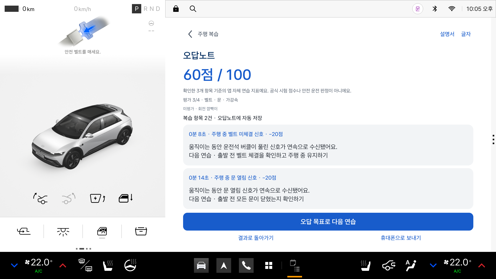

# 도로주행 도우미

개인 출품 오주현 · **0.5.9 (versionCode 25)**

[최종 시연 영상 바로 보기](#최종-시연-영상) · [최종 release APK](../apk/오주현_도로주행도우미_release.apk) · [실행 방법·환경·검증](../README.md)

제출 경로는 저장소 최상위 `apk/오주현_도로주행도우미_release.apk`입니다. Pleos Connect 2.1.0 / Android 14(API 34) / x86_64 / 2560 × 1440 환경에서 실행합니다.

0.5.9에서는 방향지시등 음성 질문의 왼쪽·오른쪽과 켜기·끄기를 구분해 답하도록 개선했습니다. [최신 변경 내용과 검증 기록](../README.md#059-질문에-맞는-방향지시등-답변)을 확인할 수 있습니다.

## 최종 시연 영상

**제출용 최종본 · 3분 16초 · MP4 · 1920 × 1080 · 12.4 MB**

https://github.com/user-attachments/assets/5a95fef3-23fa-44eb-89ed-14bec46547dd

출발 준비와 코스 선택부터 주행 중 피드백·음성 질문, 종합 점수·오답노트까지 담았습니다.

**[제출용 원본 MP4 다운로드](https://github.com/jhn-oh/dorojuhaeng-doumi/raw/refs/heads/main/video/%EC%98%A4%EC%A3%BC%ED%98%84_%EB%8F%84%EB%A1%9C%EC%A3%BC%ED%96%89%EB%8F%84%EC%9A%B0%EB%AF%B8_%EC%8B%9C%EC%97%B0%EC%98%81%EC%83%81.mp4?download=1)** · 파일명: `오주현_도로주행도우미_시연영상.mp4`

아래는 이전 0.5.8 APK에서 에뮬레이터 시험 신호로 만든 60점·오답 2건을 재실행 후 복원한 화면입니다. 현재 배포 APK는 위에 표시한 0.5.9입니다.

