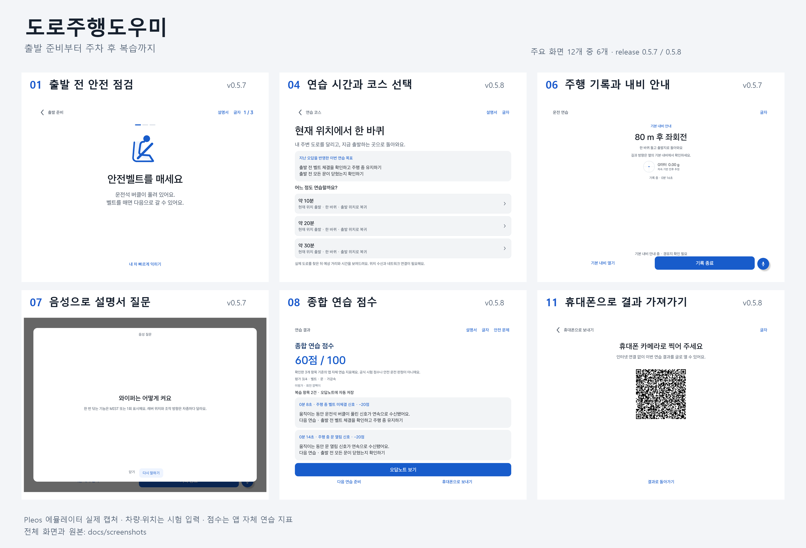
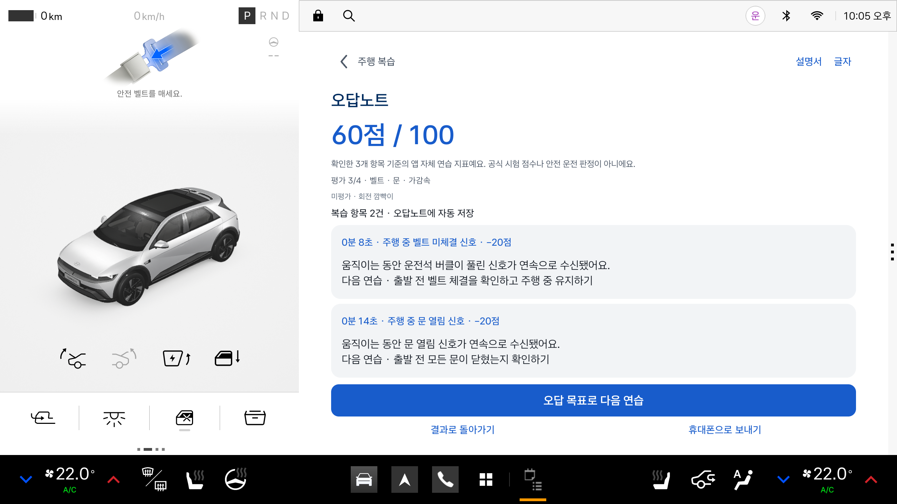

# 도로주행도우미

초보 운전자가 Pleos Connect에서 출발 준비, 내 차 조작 실습, 연습 코스와 주차 후 복습을 연결하는 차량용 Android 앱입니다.

**개인 출품: 오주현 · 최종 release 0.5.9 (versionCode 25)**

[최종 시연 영상 바로 보기](#최종-시연-영상) · [최종 APK 다운로드](#최종-apk)

## 최종 시연 영상

**제출용 최종본 · 3분 16초 · MP4 · 1920 × 1080 · 12.4 MB**

https://github.com/user-attachments/assets/5a95fef3-23fa-44eb-89ed-14bec46547dd

출발 준비와 코스 선택부터 주행 중 피드백·음성 질문, 종합 점수·오답노트까지 담았습니다.

**[제출용 원본 MP4 다운로드](https://github.com/jhn-oh/dorojuhaeng-doumi/raw/refs/heads/main/video/%EC%98%A4%EC%A3%BC%ED%98%84_%EB%8F%84%EB%A1%9C%EC%A3%BC%ED%96%89%EB%8F%84%EC%9A%B0%EB%AF%B8_%EC%8B%9C%EC%97%B0%EC%98%81%EC%83%81.mp4?download=1)** · 파일명: `오주현_도로주행도우미_시연영상.mp4`

## 주요 화면

출발 점검 → 내 차 익히기 → 코스 선택 → 주행·음성 질문 → 점수·오답 복습으로 이어집니다.

[](docs/screenshots/README.md)

**[주요 화면 12개와 차량 전체 화면 원본 보기](docs/screenshots/README.md)** · [요약 이미지](docs/screenshots/overview.png)

Pleos 에뮬레이터에서 실행한 release 0.5.7~0.5.9의 실제 캡처입니다. 각 화면의 버전과 시험 조건은 갤러리에 표시했습니다.

## 최종 APK

**[오주현_도로주행도우미_release.apk 다운로드](apk/오주현_도로주행도우미_release.apk)**

- 제출 파일 경로: `apk/오주현_도로주행도우미_release.apk` — 저장소 최상위의 `apk/` 폴더입니다.
- 패키지: `kr.juhyu.licensenote` · minSdk 28 · targetSdk 35 · release 서명 APK.
- APK SHA-256: `f7cf557e2eb93b285d5fd6f814747b70f8f14cf28bafe61fb4b026fa5f7c7405`
- [수정본 검증 기록](outputs/release-059/verification.json) · [공식 제출 요구사항 확인](outputs/release-057/submission-requirements.json)

## 0.5.9 질문에 맞는 방향지시등 답변

- 왼쪽·오른쪽 방향과 켜기·끄기를 구분합니다. ‘깜박등’, ‘방향 지시등’, ‘턴 시그널’처럼 표현을 바꾼 조작 질문도 처리합니다.
- **“왼쪽 깜빡이를 어떻게 켜요?” → “왼쪽 깜빡이를 켜려면 핸들 왼쪽 레버를 아래로 내리세요. 계기판의 왼쪽 화살표가 깜빡이는지 확인하세요.”** [쏘나타 설명서의 레버식 조작 기준](https://ownersmanual.hyundai.com/full_webhelp/DN8/2026/ko_KR/ideb4a90bce9f.html)입니다.
- 끄는 질문에는 레버를 가운데 위치로 돌려 놓고 화살표가 꺼졌는지 확인하도록 안내합니다. ‘핸들 왼쪽 레버’라는 위치 설명을 오른쪽 신호 요청과 혼동하지 않습니다.
- release 단위 검사 103개와 lint 오류 0개를 확인했습니다. 실제 서명 APK에서 합성 음성 **“왼쪽 방향지시등은 어떻게 켜요?”**의 인식·화면 답변·TTS 완료를 확인했습니다. [실제 앱 문답 화면](outputs/release-059/left-signal-answer.png)
- 음성 엔진은 기존 Pleos `ON_DEVICE`입니다. 별도 합성 질문에서 ‘깜빡이’를 ‘반파기’로 잘못 들은 사례는 남아 있으며, 이번 수정이 인식률 개선이나 실차 음성 검증을 의미하지 않습니다.

## 실행 환경과 설정

- Pleos Connect 시스템 이미지 **2.1.0**, Android 14 / API 34, x86_64.
- 화면 **2560 × 1440**, 가로 방향, 밀도 160dpi. Android Emulator **36.6.11**, host GPU, Vulkan 비활성.
- 차량 신호 공급자, 위치 권한·수신을 켭니다. 코스 탐색에는 인터넷이 필요합니다.
- 음성 질문·출력에는 Pleos STT/TTS 서비스와 에뮬레이터 오디오 입출력이 필요합니다.
- 차량 화면과 기본 내비·우리 앱의 분할 배치는 시스템 창 손잡이로 조정합니다.

## 설치와 사용

```powershell
adb devices
adb -s <serial> install -r "apk/오주현_도로주행도우미_release.apk"
```

1. 차량 앱 목록에서 **도로주행도우미**를 열고 요청하는 권한을 허용합니다. 개발용 debug APK와 release APK의 서명이 다르면 별도 시험 기기에 설치합니다.
2. 정차·P단에서 안전벨트·거울·문 점검을 진행합니다. 실제 미체결 신호가 있으면 다음 단계가 차단됩니다. 공급자가 없을 때의 직접 확인은 실제 버클 체결 신호로 처리하지 않습니다.
3. **내 차 빠르게 익히기**에서 계기판을 확인하고 깜빡이·와이퍼를 작동합니다. 화면 진입 후 새 OFF→ON 신호가 들어와야 실습이 완료됩니다.
4. 현재 위치 수신 후 연습 시간을 선택하고 **기본 내비로 연습 시작**을 누릅니다. 실제 길 안내는 기본 내비에서 확인합니다. 우측 하단 마이크로 설명서 관련 질문을 할 수 있습니다.
5. 정차·P단에서 **기록 종료**를 누릅니다. **휴대폰으로 보내기 → QR로 받기**로 결과를 가져갈 수 있습니다.

## 0.5.8 종합 점수와 오답노트

- 주행 종료 후 **종합 연습 점수 / 100**, 확인한 평가 항목 수와 미평가 항목을 표시합니다. 앱 자체 연습 지표이며 공식 시험 점수가 아닙니다.
- 벨트 미체결·문 열림 신호, 차속 기반 급가감속, 위치·진행방향·조향이 일치하는 회전의 깜빡이 연속 소등을 복습 항목으로 만듭니다.
- 감지 시점·근거·차감·다음 목표를 오답노트와 SQLite 기록에 자동 저장합니다. 재실행 후 점수와 오답을 복원하고 QR에도 요약합니다.
- **오답 목표로 다음 연습**을 누르면 코스 선택과 다음 주행 화면에 이전 오답의 연습 목표가 이어집니다. 해당 조작이 더 많이 포함된 경로를 보장하는 기능은 아닙니다.
- 주행 자료가 부족하거나 중단·안전 문제가 있으면 점수를 보류합니다. 미지원 신호와 확인하지 못한 회전은 성공으로 간주하지 않습니다.
- 기준: 확인한 항목에서 100점 시작, 벨트/문 각 20점, 추정 회전 깜빡이 10점(방향별 최대 3건), 급가감속 5점(종류별 최대 3건) 차감. 급감속 원인은 주차 후 확인합니다. 가중치는 효과가 검증된 공식 척도가 아닌 시제품의 명시적 규칙입니다.

### 실제 APK의 오답노트 화면

Pleos 에뮬레이터의 차량 시험 신호로 생성한 **60점·오답 2건**을 앱 재실행 후 복원한 화면입니다. 각 항목의 시점·근거·차감·다음 연습 목표를 표시하고, 하단의 **오답 목표로 다음 연습**으로 이어집니다.



## 이전 0.5.7 수정

- 내비의 일시적인 경로 취소 뒤에도 최신 경로·안내·목적지·경유지 콜백을 확인해 상태 표시를 복구합니다. 경유지 확인이 부족하면 확인 필요 상태로 표시합니다.
- 코스 탐색은 예상 소요 시간에 따라 경유지 거리를 보정합니다. 목표 시간과 차이가 큰 코스는 반환하지 않고 다른 시간 선택·재시도를 안내합니다.
- 저장소의 제출 APK는 위 파일 하나로 통일합니다. 이전 `apk/도로주행도우미_release.apk`는 제출 경로에서 제거했습니다.

## 소스와 빌드

검증 기록에는 release 단위 검사·lint, 설치 파일 해시, 실제 내비 안내/취소, 코스 시간, 차량 실습·화면 잠금, 저장 복원·QR, 가상 마이크 문답의 결과를 구분해 적었습니다. 10분 요청은 모델 예상 11분, 30분 요청은 29분이었고, 같은 위치의 20분 요청은 조건에 맞는 도로를 찾지 못해 재시도를 안내했습니다. 실제 소요 시간 측정 결과는 아닙니다. 녹음 질문 일부의 오인식이 관찰됐으며 인식률을 보장하지 않습니다.

소스는 [pleos-app](pleos-app/)입니다. JDK 17, Android SDK 35, Gradle Wrapper 8.10.2를 사용합니다.

```powershell
cd pleos-app
.\tools\build.ps1 -Tasks ':app:assembleRelease',':app:testReleaseUnitTest',':app:lintRelease'
```

빌드 결과는 `app/build/outputs/apk/release/app-release-unsigned.apk`입니다. 새 빌드는 본인 키로 서명해야 합니다. 제출 APK는 기존 배포 인증서로 서명되어 있으며 키·비밀번호는 저장소에 포함하지 않습니다. `showcase` 변형은 촬영용으로 분리되어 있고 제출 APK에는 촬영용 제어 수신기가 없습니다.

주변 도로는 Valhalla 공개 데모의 OpenStreetMap 도로 그래프로 계산합니다. 거리·시간은 모델 예상이며 실제 교통·도로 적합성을 보장하지 않습니다. 실제 서비스를 운영하려면 경로 공급자를 별도로 확보해야 합니다. 실차, 실제 주행 소음, 전체 코스 완주와 장시간 발열은 별도 검증 대상입니다. 운전면허시험 점수나 안전 운전 판정을 제공하지 않습니다.

[앱 상세·과거 검증](pleos-app/README.md) · [개발 요구사항](<면허연습노트/개발 요구사항.md>) · [화면과 문구](<면허연습노트/상황별 화면과 문구.md>)
