# 도로주행도우미 주요 화면

출발 점검 → 차량 조작 실습 → 코스 선택 → 주행·음성 질문 → 점수·오답 복습 → 다음 연습으로 이어지는 화면 12개입니다.

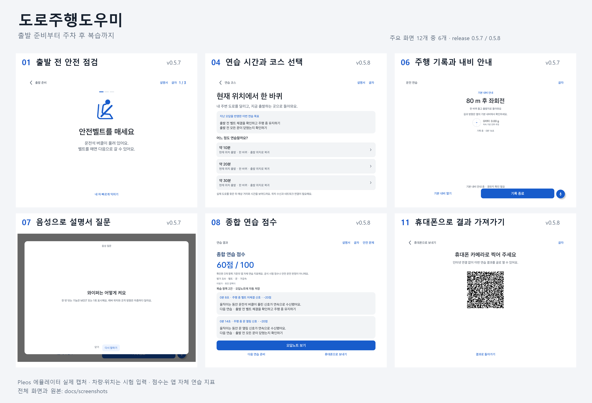

현재 저장소의 앱은 **0.5.8**입니다. 아래 이미지는 기존 검증 과정에서 남긴 **release 0.5.7·0.5.8의 실제 실행 캡처**를 화면별 버전과 함께 정리한 것입니다. 한 회차를 연속 촬영한 자료는 아닙니다.

가독성을 위해 전체 2560 × 1440 화면에서 앱 영역 1682 × 1210만 잘랐습니다. 앱 내용은 수정하지 않았으며, 각 항목의 **차량 전체 화면 원본**은 변경 없이 함께 보관했습니다. 왼쪽 차량 패널과 상·하단 시스템 UI는 앱 화면과 구분됩니다.

## 01. 출발 전 안전 점검

**release 0.5.7** · [차량 전체 화면 원본](full/01-departure.png)

벨트·거울·문을 순서대로 점검합니다. 캡처는 미체결 신호로 다음 단계가 차단된 벨트 화면입니다.

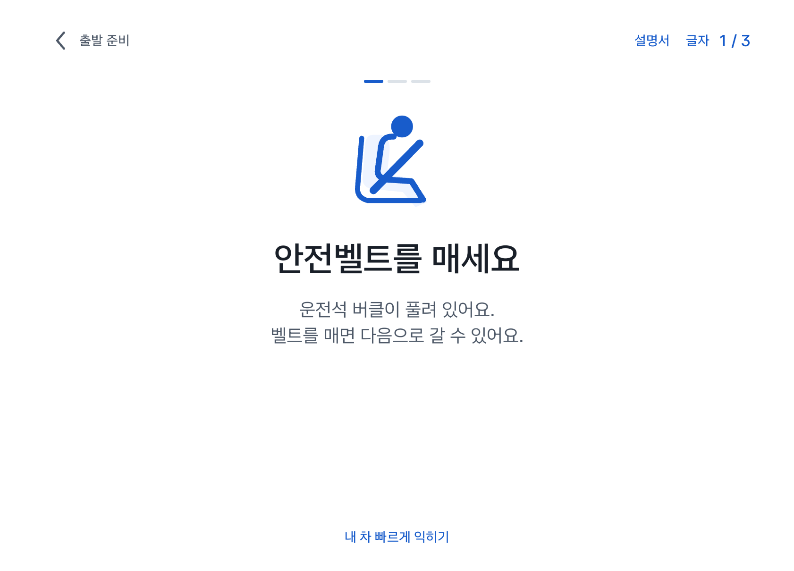

## 02. 내 차 빠르게 익히기

**release 0.5.7** · [차량 전체 화면 원본](full/02-car-overview.png)

차량에서 수신한 속도·기어·연료·배터리를 확인하고 조작 실습으로 이동합니다. 미지원 항목은 별도로 표시합니다.

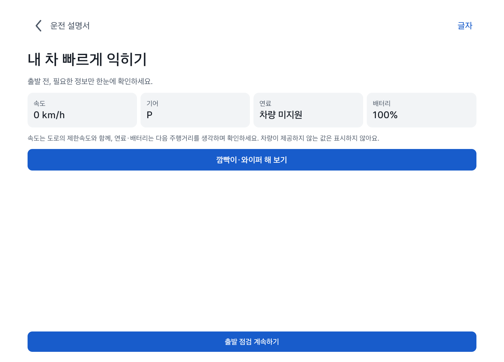

## 03. 깜빡이·와이퍼 실습

**release 0.5.7** · [차량 전체 화면 원본](full/03-controls.png)

화면 진입 뒤 새로 들어온 깜빡이·와이퍼 작동 신호를 확인한 상태입니다. 에뮬레이터의 가상 차량 조작으로 시험했습니다.

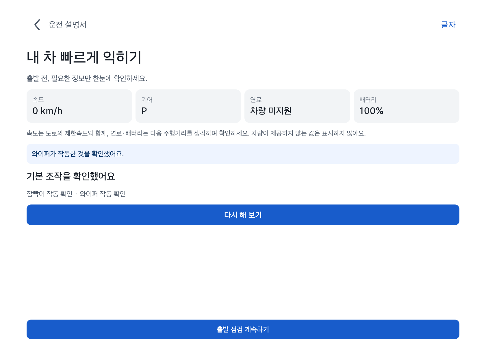

## 04. 연습 시간과 코스 선택

**release 0.5.8** · [차량 전체 화면 원본](full/04-course.png)

현재 위치에서 출발해 돌아오는 코스를 10·20·30분 중 선택합니다. 이 화면에는 지난 오답에서 가져온 벨트·문 점검 목표도 표시됩니다.

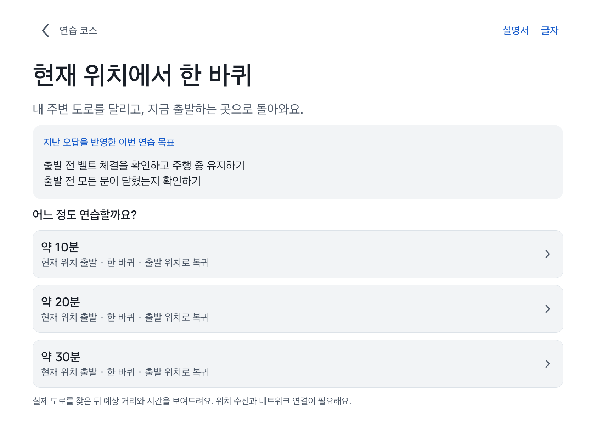

## 05. 경로 미리보기

**release 0.5.7** · [차량 전체 화면 원본](full/05-route-preview.png)

경유지, 복귀 지점, 예상 거리·시간을 확인한 뒤 기본 내비로 전달합니다. 2.4 km·약 11분은 경로 모델의 예상이며 실제 주행 시간 측정값이 아닙니다.

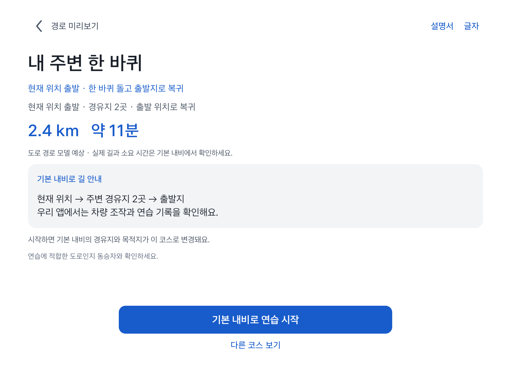

## 06. 주행 기록과 내비 안내

**release 0.5.7** · [차량 전체 화면 원본](full/06-driving.png)

기본 내비에서 수신한 다음 안내, 차속 기반 G미터, 기록 시간과 음성 질문 버튼을 표시합니다. 경유지 확인 필요 상태도 그대로 보여 줍니다.

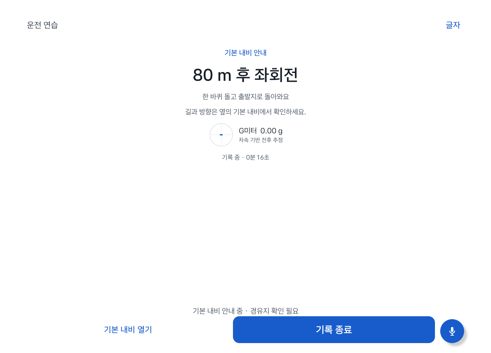

## 07. 음성으로 설명서 질문

**release 0.5.7** · [차량 전체 화면 원본](full/07-voice.png)

“와이퍼는 어떻게 켜요”라는 질문에 MIST·1회 작동 설명을 표시한 화면입니다. 합성 한국어 질문을 가상 마이크로 입력한 STT/TTS 시험이며 실제 차내 인식률을 의미하지 않습니다.

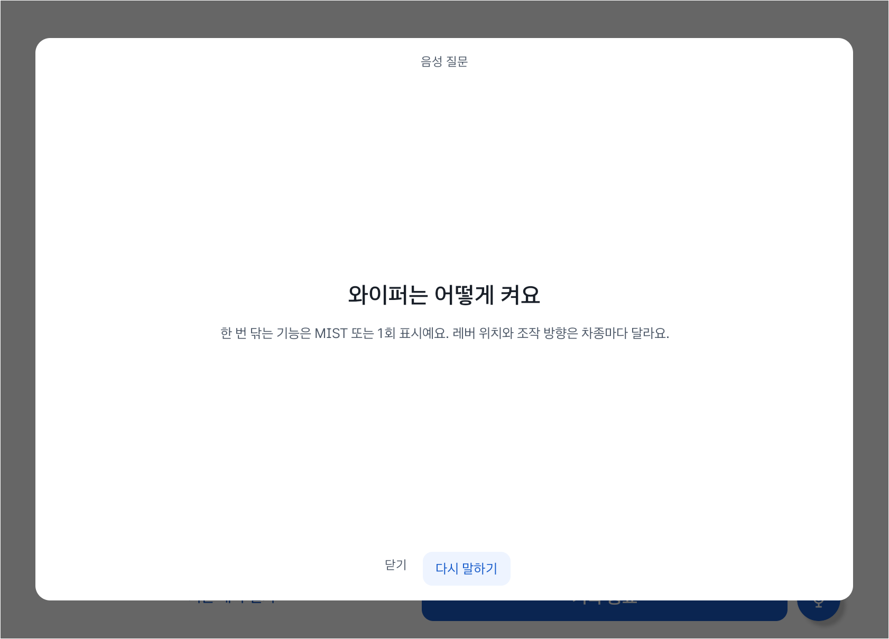

## 08. 종합 연습 점수

**release 0.5.8** · [차량 전체 화면 원본](full/08-score.png)

확인한 평가 항목, 미평가 항목과 자동 저장된 복습 항목을 표시합니다. 60점·오답 2건은 가상 벨트·문 신호로 생성한 앱 자체 연습 지표이며 공식 시험 점수가 아닙니다.

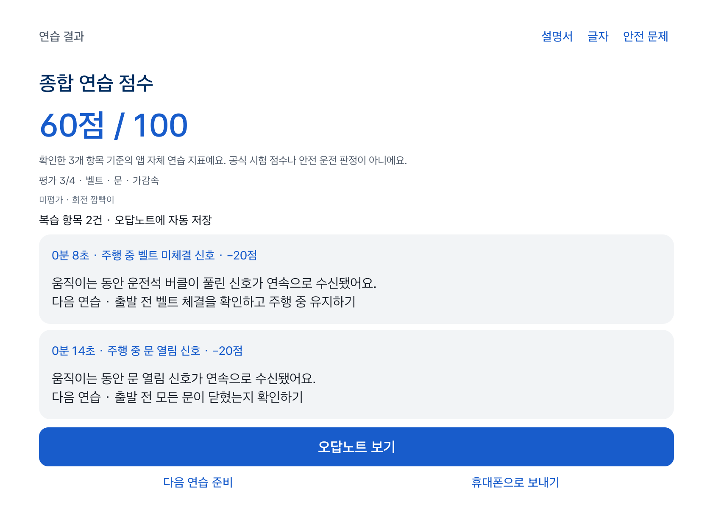

## 09. 저장된 오답노트

**release 0.5.8** · [차량 전체 화면 원본](full/09-notebook.png)

앱을 재실행한 뒤 복원한 오답노트입니다. 각 항목의 시점·근거·차감·다음 목표를 확인하고 “오답 목표로 다음 연습”으로 이어집니다.

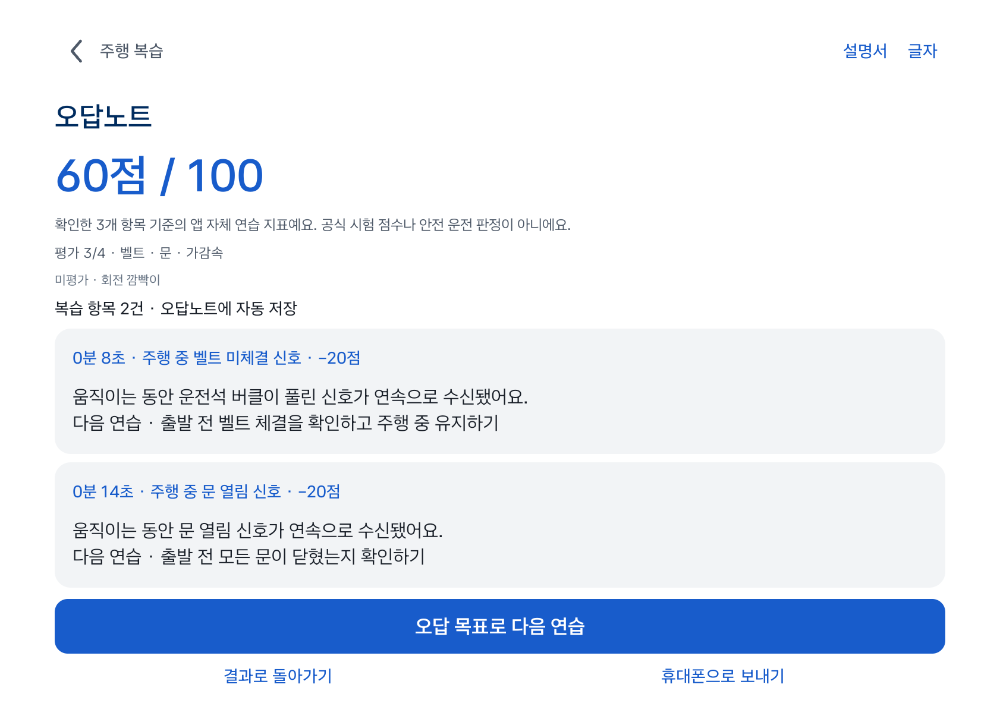

## 10. 다음 주행으로 목표 연결

**release 0.5.8** · [차량 전체 화면 원본](full/10-next-goal.png)

이전 오답에서 선택한 목표를 다음 주행 화면에 표시합니다. 이 캡처의 내비 상태는 준비 중이며, 목표에 맞는 특정 조작을 더 많이 포함하도록 경로를 최적화한 결과는 아닙니다.

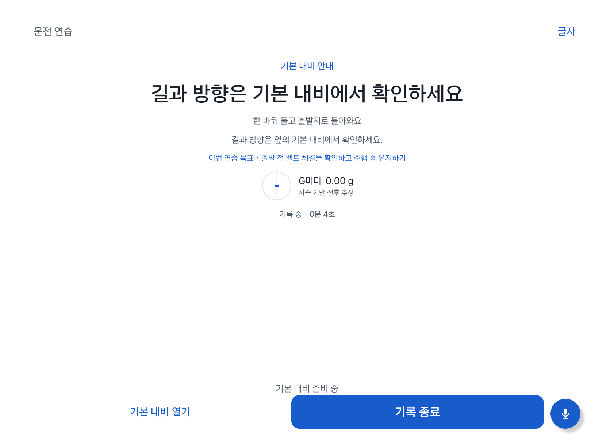

## 11. 휴대폰으로 결과 가져가기

**release 0.5.8** · [차량 전체 화면 원본](full/11-qr.png)

주차 후 결과 요약을 QR로 가져가는 화면입니다. QR에는 위 에뮬레이터 시험 회차의 텍스트 결과가 들어 있습니다.

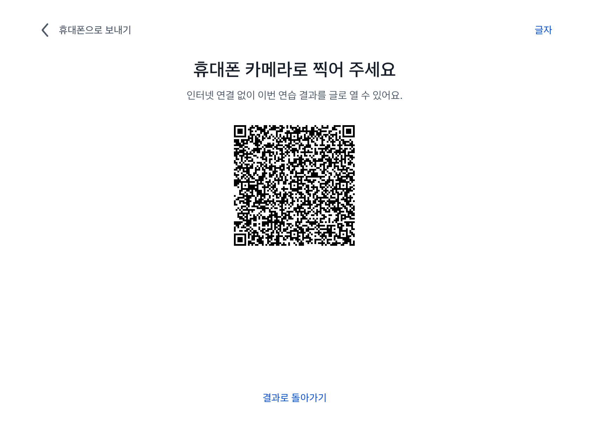

## 12. 자료 부족 시 점수 보류

**release 0.5.8** · [차량 전체 화면 원본](full/12-score-held.png)

주행 자료가 부족한 정차 회차는 점수를 보류하고 미평가 항목을 표시합니다. 오답이 없다는 이유만으로 100점을 부여하지 않습니다.

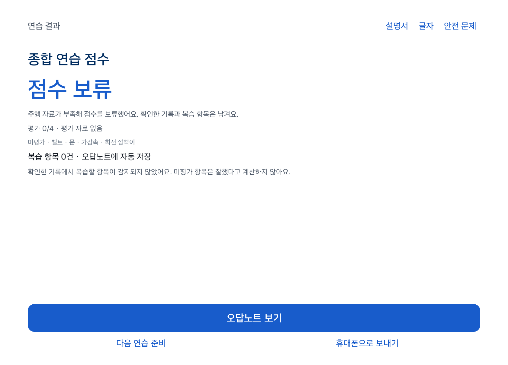

## 촬영·검증 범위

- Pleos Connect 2.1.0 / Android 14 API 34 / x86_64 에뮬레이터에서 실행한 서명 release APK입니다.
- 차량 값과 위치는 가상 차량 조작·GNSS 시험 입력입니다. 실차 주행, 실제 마이크·차내 소음, 전체 코스 완주나 장시간 동작을 검증한 자료는 아닙니다.
- 경로 거리·시간은 도로 경로 모델의 예상입니다. 음성 질문은 합성 음성을 가상 마이크에 입력한 성공 사례이며 인식률을 보장하지 않습니다.
- 점수와 오답은 앱 자체 규칙에 따른 연습용 기록입니다. 공식 면허시험 점수나 안전 운전 판정이 아닙니다.
- [0.5.7 검증 기록](../../outputs/release-057/verification.json) · [0.5.8 검증 기록](../../outputs/release-058/verification.json)
- [이미지별 원자료 경로·버전·SHA-256](sources.json) · [저장소 안내](../../README.md)
